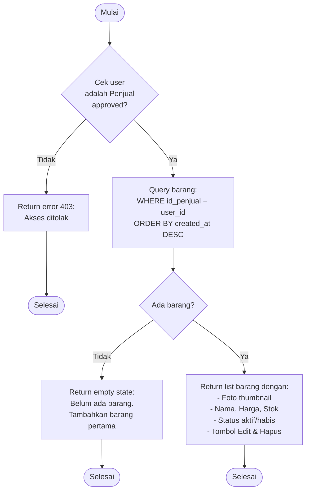

# Flowchart - BarangSayaController

## Penjelasan Algoritma

**Input:**
- (tidak ada input, hanya cek session)

**Proses:**
1. **Cek Status Penjual**
   - Validasi user adalah penjual approved
   - Cek is_seller = 1

2. **Query Barang**
   - Ambil semua barang milik penjual yang login
   - ORDER BY created_at DESC (terbaru dulu)

3. **Tampilkan List**
   - Jika tidak ada → empty state
   - Jika ada → tampilkan dengan tombol aksi

**Output:**
- **Success:** Tampilkan list barang dengan tombol Edit & Hapus
- **Empty:** Tampilkan empty state dengan link tambah barang
- **Error:** Error 403 jika bukan penjual approved
