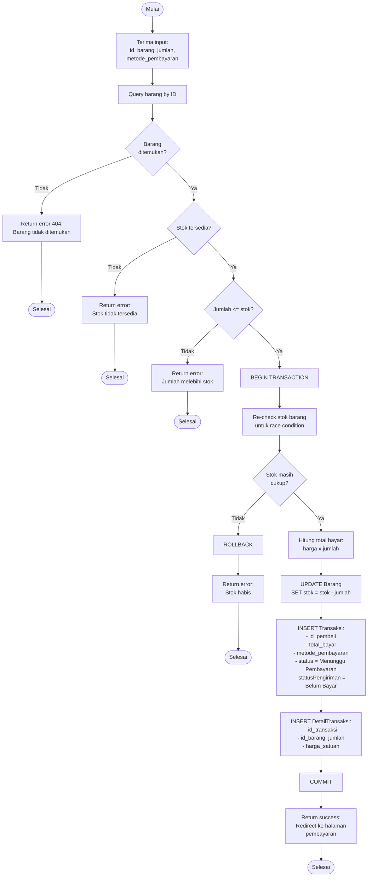

# Flowchart - BeliBarangController (Checkout)

## Penjelasan Algoritma

**Input:**
- id_barang (integer)
- jumlah (integer)
- metode_pembayaran (string)

**Proses:**
1. **Query Barang**
   - Cari barang by ID
   - Cek keberadaan

2. **Validasi Stok**
   - Cek stok > 0
   - Cek jumlah <= stok

3. **BEGIN TRANSACTION**
   - Re-check stok (handle race condition)
   - Hitung total bayar
   - Kurangi stok barang
   - INSERT transaksi dengan status 'Menunggu Pembayaran'
   - INSERT detail transaksi
   - COMMIT

4. **ROLLBACK jika stok habis**
   - Untuk mencegah overselling

**Output:**
- **Success:** Redirect ke halaman pembayaran
- **Error:** Tampilkan pesan error
