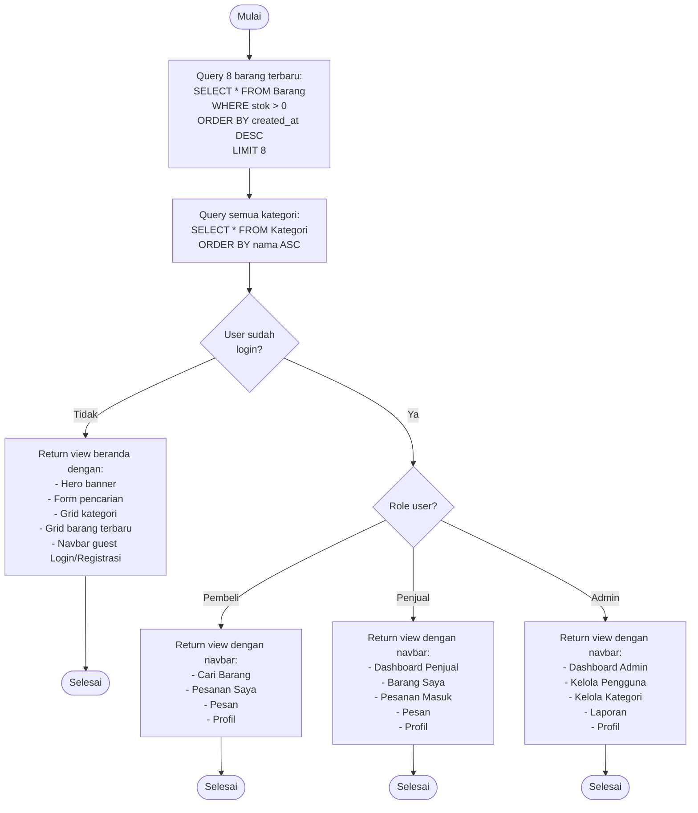

# Flowchart - BerandaController

## Penjelasan Algoritma

**Input:**
- (tidak ada input, hanya load data)

**Proses:**
1. **Query Barang Terbaru**
   - SELECT 8 barang dengan stok > 0
   - ORDER BY created_at DESC
   - Ambil foto, nama, harga

2. **Query Kategori**
   - SELECT semua kategori aktif
   - ORDER BY nama ASC

3. **Cek Status Login**
   - Jika tidak login → navbar guest
   - Jika login → navbar sesuai role

4. **Render View**
   - Hero banner
   - Form pencarian quick
   - Grid kategori (clickable)
   - Grid barang terbaru
   - Call to action buttons

**Output:**
- **Halaman beranda** dengan konten sesuai status login dan role user
