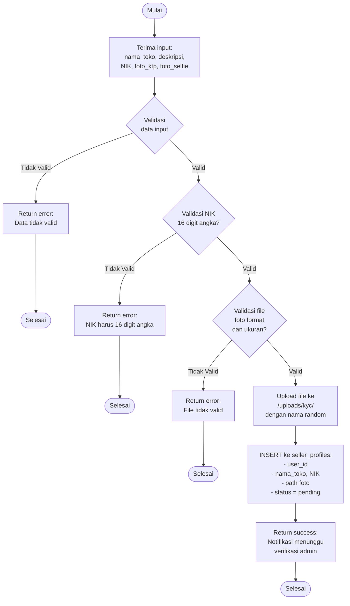

# Flowchart - BukaTokoController (Daftar Penjual KYC)

## Penjelasan Algoritma

**Input:**
- nama_toko (string)
- deskripsi_toko (string)
- nik (string, 16 digit)
- foto_ktp (file)
- foto_selfie (file)

**Proses:**
1. **Validasi Data Input**
   - Cek semua field tidak kosong
   - Cek nama toko dan deskripsi

2. **Validasi NIK**
   - Cek panjang = 16 karakter
   - Cek hanya berisi angka

3. **Validasi File**
   - Cek format: JPG, PNG
   - Cek ukuran maksimal 2MB
   - Cek MIME type

4. **Upload File**
   - Simpan file ke folder /uploads/kyc/
   - Generate nama file random untuk keamanan

5. **Simpan ke Database**
   - INSERT record ke tabel seller_profiles
   - Set status = 'pending'

**Output:**
- **Success:** Notifikasi "Menunggu verifikasi admin"
- **Error:** Tampilkan pesan error sesuai kondisi
