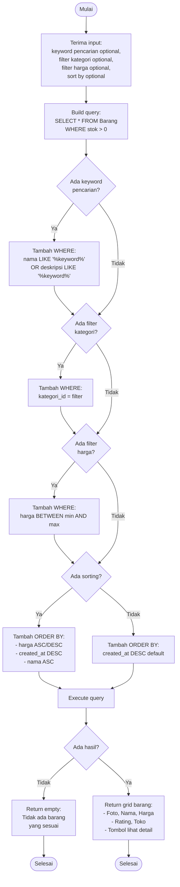

# Flowchart - CariBarangController

## Penjelasan Algoritma

**Input:**
- keyword (string, optional)
- kategori_id (integer, optional)
- harga_min (decimal, optional)
- harga_max (decimal, optional)
- sort_by (string: harga_asc/harga_desc/terbaru/nama)

**Proses:**
1. **Build Query**
   - Base query: SELECT barang WHERE stok > 0

2. **Filter Keyword**
   - Jika ada keyword → cari di nama atau deskripsi

3. **Filter Kategori**
   - Jika ada kategori_id → filter by kategori

4. **Filter Harga**
   - Jika ada range harga → filter BETWEEN min AND max

5. **Sorting**
   - Default: created_at DESC (terbaru)
   - Optional: harga ASC/DESC, nama ASC

6. **Execute & Return**
   - Jika ada hasil → tampilkan grid
   - Jika kosong → tampilkan empty state

**Output:**
- **Success:** Grid barang hasil pencarian
- **Empty:** Pesan "Tidak ada barang yang sesuai"
