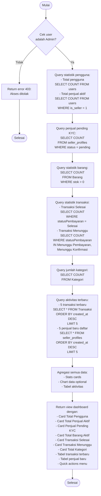

# Flowchart - DashboardAdminController

## Penjelasan Algoritma

**Input:**
- (tidak ada input, hanya load data statistik)

**Proses:**
1. **Cek Admin**
   - Validasi user adalah admin

2. **Query Statistik Pengguna**
   - Total pengguna: COUNT dari tabel users
   - Total penjual aktif: COUNT WHERE is_seller = 1

3. **Query Penjual Pending KYC**
   - COUNT dari seller_profiles WHERE status = 'pending'

4. **Query Statistik Barang**
   - Total barang aktif: COUNT WHERE stok > 0

5. **Query Statistik Transaksi**
   - Transaksi selesai: COUNT WHERE statusPembayaran = 'Selesai'
   - Transaksi menunggu: COUNT WHERE status IN ('Menunggu Pembayaran', 'Menunggu Konfirmasi')

6. **Query Jumlah Kategori**
   - COUNT dari tabel Kategori

7. **Query Aktivitas Terbaru**
   - 5 transaksi terbaru (ORDER BY created_at DESC LIMIT 5)
   - 5 penjual baru daftar (ORDER BY created_at DESC LIMIT 5)

8. **Agregasi & Render**
   - Gabungkan semua data
   - Render view dashboard dengan stats cards dan tabel

**Output:**
- **Success:** Dashboard admin dengan semua statistik dan aktivitas terbaru
- **Error:** Error 403 jika bukan admin
