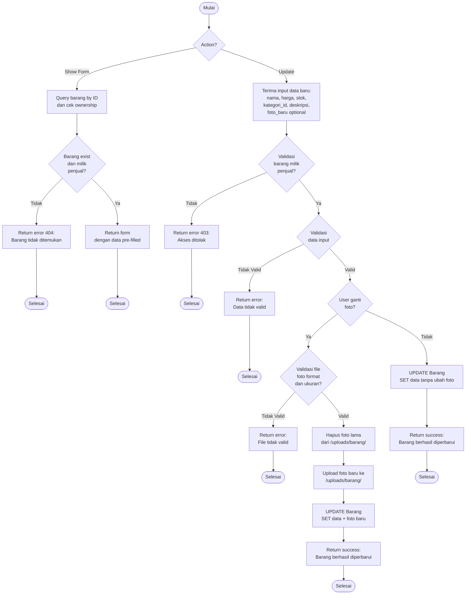

# Flowchart - EditBarangController

## Penjelasan Algoritma

**Input:**
- id_barang (integer)
- nama_barang (string, optional)
- harga (decimal, optional)
- stok (integer, optional)
- kategori_id (integer, optional)
- deskripsi (text, optional)
- foto_baru (file, optional)

**Proses:**
1. **Show Form (GET)**
   - Query barang by ID
   - Validasi ownership (barang milik penjual yang login)
   - Tampilkan form pre-filled

2. **Update (POST)**
   - Validasi ownership
   - Validasi data input
   - Jika ganti foto:
     - Validasi file
     - Hapus foto lama
     - Upload foto baru
   - Update data ke database

**Output:**
- **Success:** Notifikasi "Barang berhasil diperbarui"
- **Error:** Tampilkan pesan error
