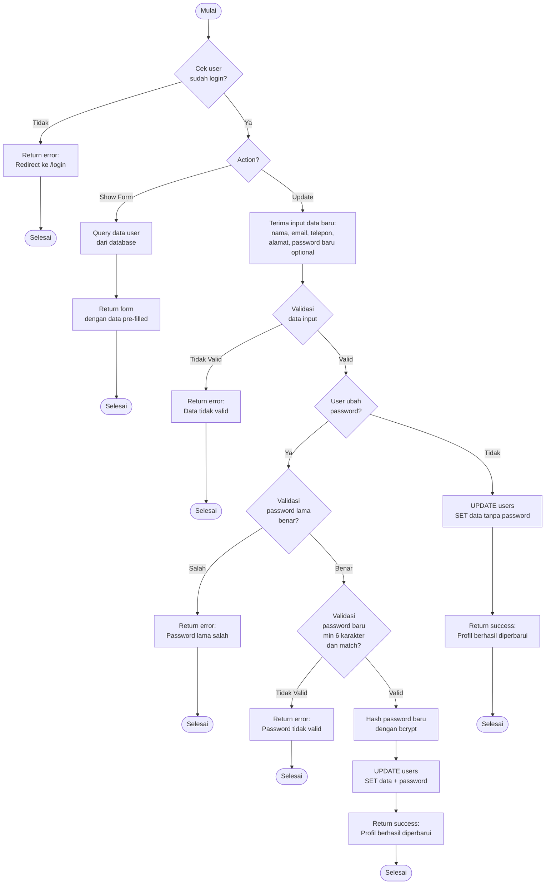

# Flowchart - EditDataPribadiController

## Penjelasan Algoritma

**Input:**
- nama_lengkap (string, optional)
- email (string, optional)
- telepon (string, optional)
- alamat (string, optional)
- password_lama (string, optional)
- password_baru (string, optional)
- password_konfirmasi (string, optional)

**Proses:**
1. **Cek Login**
   - Validasi user sudah login

2. **Show Form (GET)**
   - Query data user saat ini
   - Tampilkan form pre-filled

3. **Update (POST)**
   - Validasi data input
   - Jika ubah password:
     - Verifikasi password lama
     - Validasi password baru
     - Hash password baru
   - Update data ke database

**Output:**
- **Success:** Notifikasi "Profil berhasil diperbarui"
- **Error:** Tampilkan pesan error sesuai kondisi
