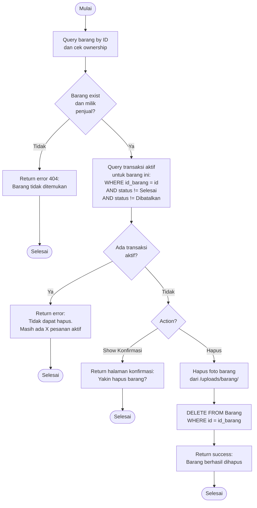

# Flowchart - HapusBarangController

## Penjelasan Algoritma

**Input:**
- id_barang (integer)

**Proses:**
1. **Query Barang**
   - Cari barang by ID
   - Validasi ownership (milik penjual yang login)

2. **Cek Transaksi Aktif**
   - Query transaksi yang belum selesai/dibatalkan
   - Jika ada → tidak bisa hapus

3. **Show Konfirmasi (GET)**
   - Tampilkan halaman konfirmasi

4. **Hapus (POST)**
   - Hapus file foto dari server
   - DELETE record dari database

**Output:**
- **Success:** Notifikasi "Barang berhasil dihapus"
- **Error:** Tampilkan pesan error
