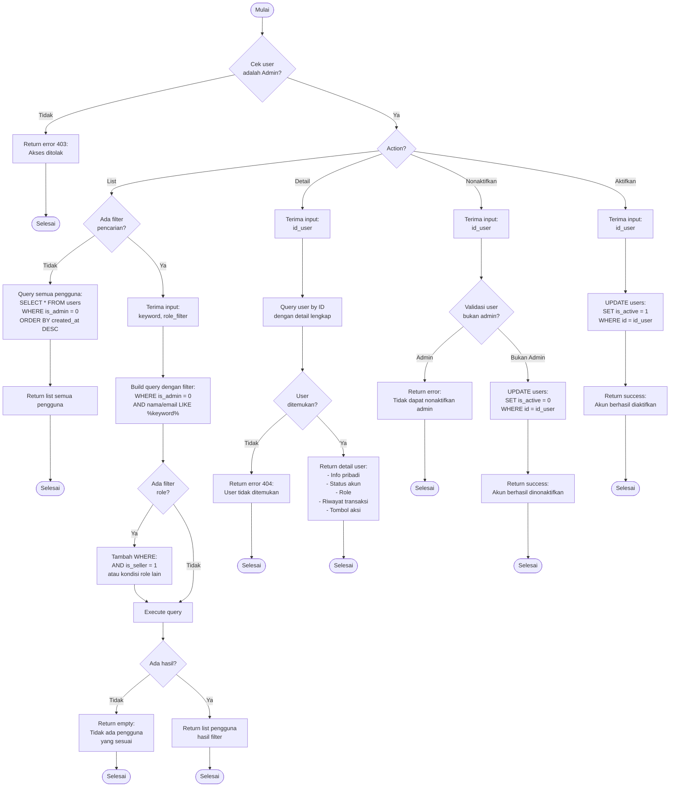

# Flowchart - KelolaAkunPenggunaController (Admin)

## Penjelasan Algoritma

**Input:**
- action (string: list/detail/nonaktifkan/aktifkan)
- id_user (integer, untuk detail/nonaktifkan/aktifkan)
- keyword (string, optional untuk filter)
- role_filter (string, optional: pembeli/penjual/semua)

**Proses:**
1. **Cek Admin**
   - Validasi user adalah admin

2. **List Pengguna**
   - Jika tidak ada filter → query semua
   - Jika ada filter:
     - Filter by keyword (nama/email)
     - Filter by role (is_seller)
   - Exclude admin dari list

3. **Detail User**
   - Query user by ID
   - Tampilkan detail lengkap dengan riwayat

4. **Nonaktifkan Akun**
   - Validasi user bukan admin
   - UPDATE is_active = 0
   - User tidak bisa login

5. **Aktifkan Akun**
   - UPDATE is_active = 1
   - User bisa login kembali

**Output:**
- **Success:** Data atau notifikasi sesuai action
- **Error:** Tampilkan pesan error
