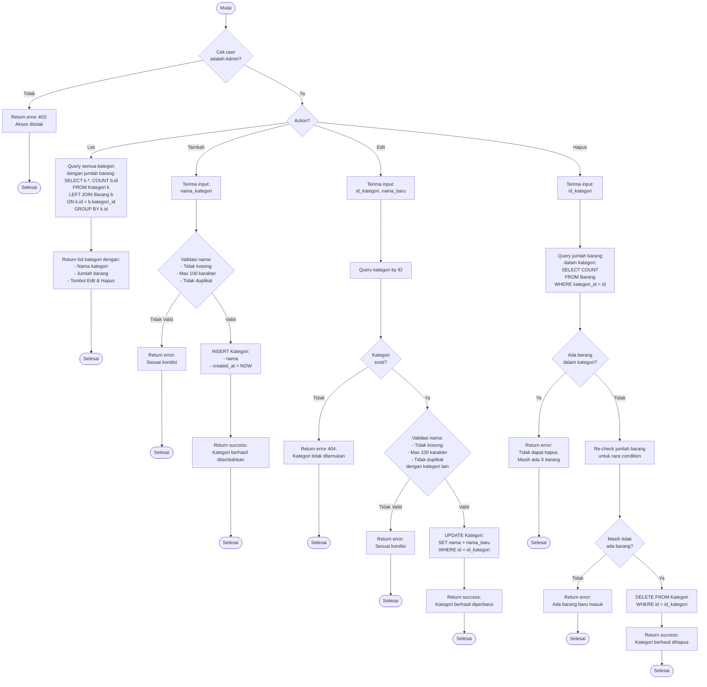

# Flowchart - KelolaKategoriController (Admin)

## Penjelasan Algoritma

**Input:**
- action (string: list/tambah/edit/hapus)
- id_kategori (integer, untuk edit/hapus)
- nama_kategori (string, untuk tambah/edit)

**Proses:**
1. **Cek Admin**
   - Validasi user adalah admin

2. **List Kategori**
   - Query semua kategori dengan COUNT barang
   - Tampilkan dengan tombol Edit & Hapus

3. **Tambah Kategori**
   - Validasi nama:
     - Tidak kosong
     - Maksimal 100 karakter
     - Tidak duplikat
   - INSERT ke database

4. **Edit Kategori**
   - Query kategori by ID
   - Validasi nama (tidak duplikat dengan kategori lain)
   - UPDATE database

5. **Hapus Kategori**
   - Cek jumlah barang dalam kategori
   - Jika ada barang → tidak bisa hapus
   - Re-check untuk handle race condition
   - DELETE dari database

**Output:**
- **Success:** Notifikasi sesuai action
- **Error:** Tampilkan pesan error
