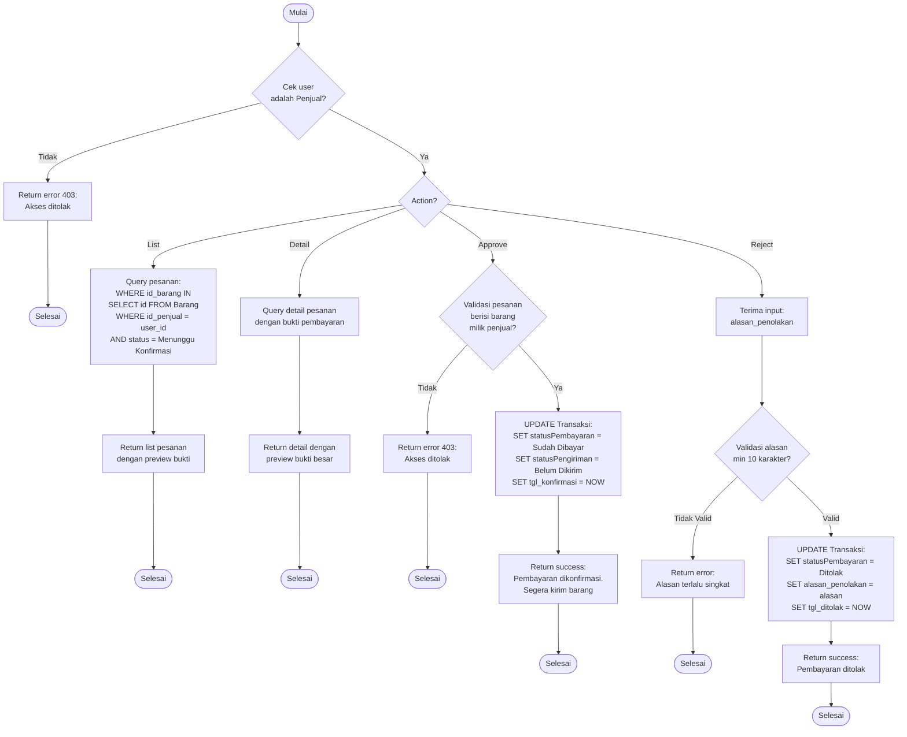

# Flowchart - KonfirmasiPembayaranController (Penjual)

## Penjelasan Algoritma

**Input:**
- action (string: list/detail/approve/reject)
- id_transaksi (integer, untuk detail/approve/reject)
- alasan_penolakan (string, untuk reject)

**Proses:**
1. **Cek Penjual**
   - Validasi user adalah penjual

2. **List Pesanan**
   - Query pesanan yang berisi barang milik penjual
   - Filter status = 'Menunggu Konfirmasi'

3. **Detail Pesanan**
   - Query detail dengan bukti pembayaran

4. **Approve**
   - Validasi ownership
   - Update status = 'Sudah Dibayar'
   - Update statusPengiriman = 'Belum Dikirim'

5. **Reject**
   - Validasi alasan minimal 10 karakter
   - Update status = 'Ditolak'
   - Simpan alasan

**Output:**
- **Success:** Notifikasi sesuai action
- **Error:** Tampilkan pesan error
