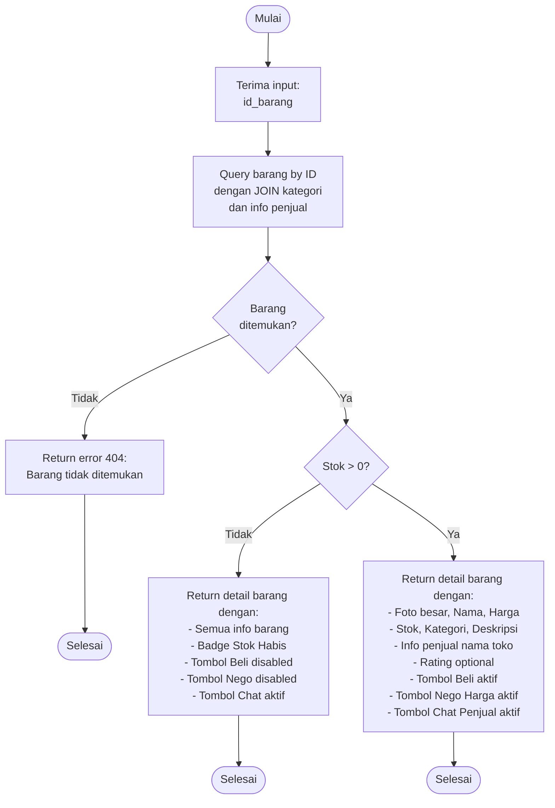

# Flowchart - LihatInformasiBarangController (Detail Barang)

## Penjelasan Algoritma

**Input:**
- id_barang (integer)

**Proses:**
1. **Query Barang**
   - SELECT barang dengan JOIN:
     - kategori (untuk nama kategori)
     - user/penjual (untuk info penjual)
   - WHERE id = id_barang

2. **Cek Keberadaan**
   - Jika tidak ditemukan → error 404

3. **Cek Stok**
   - Jika stok = 0:
     - Tampilkan dengan badge "Stok Habis"
     - Disable tombol Beli dan Nego
   - Jika stok > 0:
     - Semua tombol aktif

**Output:**
- **Success:** Halaman detail barang lengkap dengan tombol aksi
- **Stok Habis:** Detail dengan tombol Beli disabled
- **Error:** Error 404
