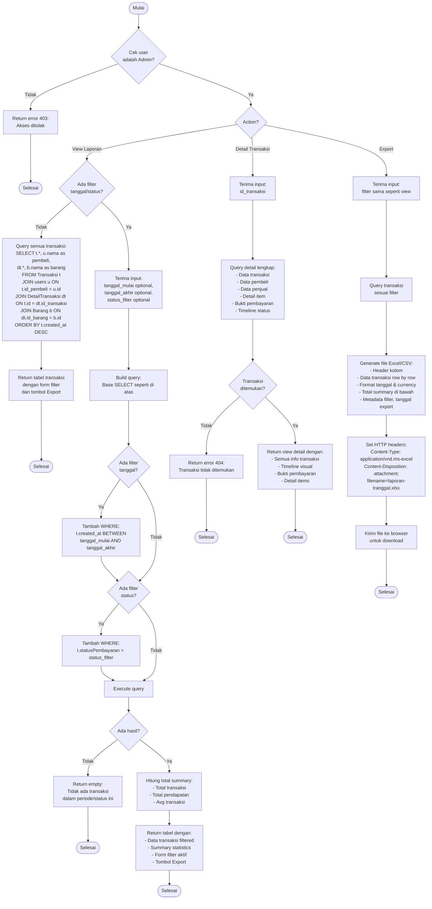

# Flowchart - LihatLaporanTransaksiController (Admin)

## Penjelasan Algoritma

**Input:**
- action (string: view/detail/export)
- tanggal_mulai (date, optional untuk filter)
- tanggal_akhir (date, optional untuk filter)
- status_filter (string, optional: Menunggu Pembayaran/Sudah Dibayar/Selesai/Dibatalkan)
- id_transaksi (integer, untuk detail)

**Proses:**
1. **Cek Admin**
   - Validasi user adalah admin

2. **View Laporan**
   - Query transaksi dengan JOIN:
     - users (untuk nama pembeli)
     - DetailTransaksi (untuk item)
     - Barang (untuk nama barang)
   - Jika ada filter:
     - Filter by rentang tanggal
     - Filter by status pembayaran
   - Hitung summary statistics
   - Tampilkan tabel dengan form filter

3. **Detail Transaksi**
   - Query detail lengkap satu transaksi
   - Tampilkan dengan timeline visual

4. **Export Laporan**
   - Query transaksi sesuai filter yang sama
   - Generate file Excel/CSV dengan:
     - Header kolom
     - Data transaksi
     - Format tanggal dan currency
     - Total summary
     - Metadata (filter, tanggal export)
   - Set headers untuk download
   - Kirim file ke browser

**Output:**
- **Success:** Tabel laporan atau file download
- **Error:** Tampilkan pesan error
