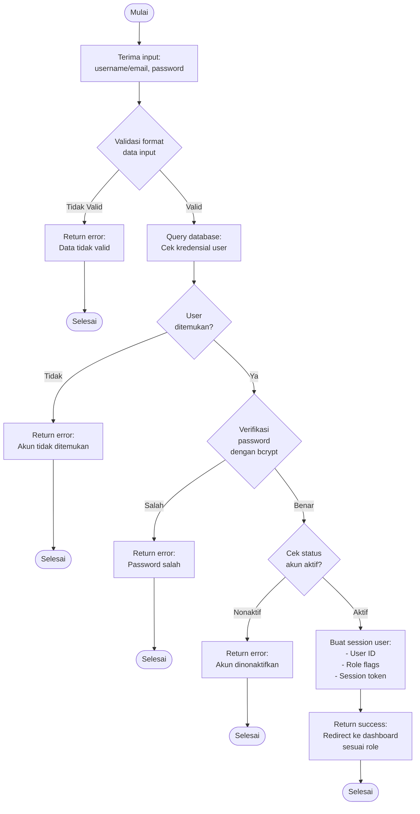

# Flowchart - LoginController

## Penjelasan Algoritma

**Input:**
- username_or_email (string)
- password (string)

**Proses:**
1. **Validasi Format Data**
   - Cek username/email tidak kosong
   - Cek password tidak kosong

2. **Query User**
   - Cari user berdasarkan username atau email

3. **Verifikasi Password**
   - Gunakan bcrypt verify untuk cek password

4. **Cek Status Akun**
   - Cek is_active = 1

5. **Buat Session**
   - Simpan user_id, role, dan token ke session

**Output:**
- **Success:** Redirect ke dashboard sesuai role (admin/penjual/pembeli)
- **Error:** Tampilkan pesan error sesuai kondisi
