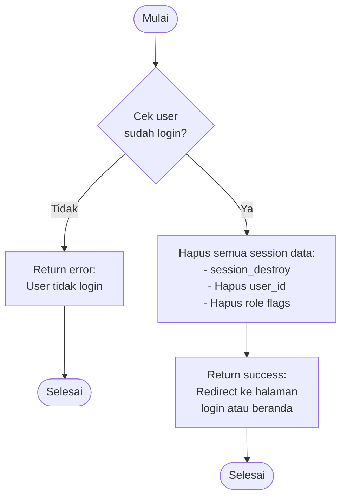

# Flowchart - LogoutController

## Penjelasan Algoritma

**Input:**
- (tidak ada input eksplisit, hanya cek session)

**Proses:**
1. **Cek Session**
   - Cek apakah user sudah login dengan cek session user_id

2. **Destroy Session**
   - Hapus semua data session
   - Panggil session_destroy()

**Output:**
- **Success:** Redirect ke halaman login atau beranda
- **Error:** User tidak login (jarang terjadi)
