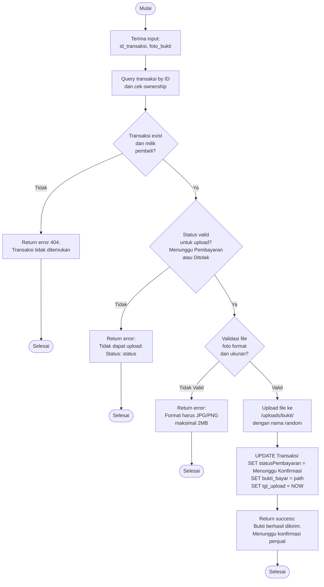

# Flowchart - PembayaranController (Upload Bukti Bayar)

## Penjelasan Algoritma

**Input:**
- id_transaksi (integer)
- foto_bukti (file)

**Proses:**
1. **Query Transaksi**
   - Cari transaksi by ID
   - Validasi ownership (milik pembeli yang login)

2. **Cek Status**
   - Status harus 'Menunggu Pembayaran' atau 'Ditolak'
   - Jika status lain → tidak bisa upload

3. **Validasi File**
   - Format: JPG, PNG
   - Ukuran maksimal 2MB
   - MIME type valid

4. **Upload & Update**
   - Simpan file ke /uploads/bukti/
   - Update status menjadi 'Menunggu Konfirmasi'
   - Simpan path bukti dan tanggal upload

**Output:**
- **Success:** Notifikasi "Bukti berhasil dikirim"
- **Error:** Tampilkan pesan error
