# Flowchart - PesanController (Chat & Messaging)

```mermaid
flowchart TD
    Start([Mulai]) --> CekLogin{Cek user<br/>sudah login?}
    
    CekLogin -->|Tidak| ErrorLogin[Return error:<br/>Redirect ke /login]
    ErrorLogin --> End1([Selesai])
    
    CekLogin -->|Ya| Action{Action?}
    
    Action -->|List Partner| QueryPartner[Query daftar partner chat<br/>dengan pesan terakhir<br/>dan unread count]
    QueryPartner --> AdaPartner{Ada partner?}
    
    AdaPartner -->|Tidak| EmptyPartner[Return empty state:<br/>Belum ada percakapan]
    EmptyPartner --> End2([Selesai])
    
    AdaPartner -->|Ya| ReturnPartner[Return list partner:<br/>- Foto, Nama<br/>- Preview pesan terakhir<br/>- Timestamp<br/>- Badge unread]
    ReturnPartner --> End3([Selesai])
    
    Action -->|Chat| InputPartner[Terima input:<br/>partner_id, barang_id optional,<br/>nego optional]
    InputPartner --> ValidasiPartner{Validasi<br/>partner exist<br/>dan bukan<br/>diri sendiri?}
    
    ValidasiPartner -->|Tidak Valid| ErrorPartner[Return error:<br/>Partner tidak valid]
    ErrorPartner --> End4([Selesai])
    
    ValidasiPartner -->|Valid| QueryRiwayat[Query riwayat chat<br/>antara user dan partner<br/>ORDER BY created_at ASC]
    QueryRiwayat --> AdaNego{Ada parameter<br/>nego?}
    
    AdaNego -->|Ya| QueryBarang[Query data barang<br/>untuk panel nego]
    QueryBarang --> ReturnChatNego[Return halaman chat dengan:<br/>- Panel nego di atas<br/>- Riwayat chat<br/>- Form input pesan]
    ReturnChatNego --> End5([Selesai])
    
    AdaNego -->|Tidak| ReturnChat[Return halaman chat:<br/>- Riwayat chat<br/>- Form input pesan]
    ReturnChat --> End6([Selesai])
    
    Action -->|Kirim Pesan| InputPesan[Terima input:<br/>partner_id, isi_pesan]
    InputPesan --> ValidasiPesan{Validasi pesan<br/>tidak kosong<br/>dan max 1000<br/>karakter?}
    
    ValidasiPesan -->|Tidak Valid| ErrorPesan[Return error:<br/>Pesan tidak valid]
    ErrorPesan --> End7([Selesai])
    
    ValidasiPesan -->|Valid| InsertPesan[INSERT Pesan:<br/>- pengirim_id<br/>- penerima_id<br/>- isi_pesan<br/>- is_read = 0<br/>- created_at = NOW]
    InsertPesan --> SuccessPesan[Return success:<br/>Append bubble pesan<br/>dan kosongkan textarea]
    SuccessPesan --> End8([Selesai])
    
    Action -->|Kirim Nego| InputNego[Terima input:<br/>id_barang, harga_tawaran]
    InputNego --> ValidasiHarga{Validasi harga:<br/>0 < harga < harga_asli?}
    
    ValidasiHarga -->|Tidak Valid| ErrorHarga[Return error:<br/>Harga tawaran tidak valid]
    ErrorHarga --> End9([Selesai])
    
    ValidasiHarga -->|Valid| CekTawaranAktif[Query tawaran aktif<br/>untuk barang ini]
    CekTawaranAktif --> AdaTawaran{Sudah ada<br/>tawaran pending?}
    
    AdaTawaran -->|Ya| ErrorTawaran[Return error:<br/>Sudah ada tawaran aktif]
    ErrorTawaran --> End10([Selesai])
    
    AdaTawaran -->|Tidak| InsertNego[INSERT ke tabel Nego:<br/>- id_barang<br/>- id_pembeli<br/>- harga_tawaran<br/>- status = pending]
    InsertNego --> InsertPesanNego[INSERT Pesan otomatis<br/>dengan format nego]
    InsertPesanNego --> SuccessNego[Return success:<br/>Tawaran dikirim]
    SuccessNego --> End11([Selesai])
    
    Action -->|Terima/Tolak Nego| InputRespon[Terima input:<br/>id_nego, aksi approve/reject]
    InputRespon --> QueryNego[Query nego by ID<br/>dan validasi ownership]
    QueryNego --> NegoValid{Nego exist<br/>dan barang<br/>milik penjual?}
    
    NegoValid -->|Tidak| ErrorNegoOwner[Return error 403:<br/>Akses ditolak]
    ErrorNegoOwner --> End12([Selesai])
    
    NegoValid -->|Ya| AksiNego{Aksi?}
    
    AksiNego -->|Approve| UpdateApprove[UPDATE Nego:<br/>SET status = diterima<br/>SET harga_kesepakatan]
    UpdateApprove --> InsertPesanApprove[INSERT Pesan otomatis:<br/>Tawaran diterima]
    InsertPesanApprove --> SuccessApprove[Return success:<br/>Tawaran diterima]
    SuccessApprove --> End13([Selesai])
    
    AksiNego -->|Reject| UpdateReject[UPDATE Nego:<br/>SET status = ditolak]
    UpdateReject --> InsertPesanReject[INSERT Pesan otomatis:<br/>Tawaran ditolak]
    InsertPesanReject --> SuccessReject[Return success:<br/>Tawaran ditolak]
    SuccessReject --> End14([Selesai])
    
    Action -->|Hapus Riwayat| InputHapus[Terima input:<br/>partner_id]
    InputHapus --> CekRiwayat{Ada riwayat<br/>chat?}
    
    CekRiwayat -->|Tidak| ErrorNoChat[Return info:<br/>Tidak ada riwayat]
    ErrorNoChat --> End15([Selesai])
    
    CekRiwayat -->|Ya| SoftDelete[UPDATE Pesan:<br/>SET deleted_by_user_id<br/>untuk sembunyikan dari user]
    SoftDelete --> SuccessHapus[Return success:<br/>Riwayat chat dihapus]
    SuccessHapus --> End16([Selesai])
    
    Action -->|Inbox Unread| QueryUnread[Query pesan unread:<br/>WHERE penerima_id = user_id<br/>AND is_read = 0]
    QueryUnread --> AdaUnread{Ada unread?}
    
    AdaUnread -->|Tidak| EmptyUnread[Return empty state:<br/>Tidak ada pesan baru]
    EmptyUnread --> End17([Selesai])
    
    AdaUnread -->|Ya| ReturnUnread[Return list pesan unread<br/>dengan preview]
    ReturnUnread --> End18([Selesai])
    
    Action -->|Mark as Read| UpdateRead[UPDATE Pesan:<br/>SET is_read = 1<br/>WHERE id IN ids]
    UpdateRead --> SuccessRead[Return success:<br/>Badge count berkurang]
    SuccessRead --> End19([Selesai])
```

## Penjelasan Algoritma

**Input:**
- action (string: list_partner/chat/kirim_pesan/kirim_nego/terima_tolak_nego/hapus_riwayat/inbox_unread/mark_as_read)
- partner_id (integer, optional)
- id_barang (integer, optional untuk nego)
- isi_pesan (text, untuk kirim_pesan)
- harga_tawaran (decimal, untuk kirim_nego)
- id_nego (integer, untuk terima/tolak)
- aksi_nego (string: approve/reject)

**Proses:**
1. **List Partner Chat**
   - Query daftar partner dengan pesan terakhir dan unread count

2. **Chat (Show)**
   - Validasi partner exist dan bukan diri sendiri
   - Query riwayat chat
   - Jika ada parameter nego → tampilkan panel nego

3. **Kirim Pesan**
   - Validasi isi pesan (tidak kosong, max 1000 karakter)
   - INSERT ke tabel Pesan

4. **Kirim Nego**
   - Validasi harga tawaran (0 < harga < harga asli)
   - Cek tidak ada tawaran pending
   - INSERT ke tabel Nego
   - INSERT pesan otomatis

5. **Terima/Tolak Nego**
   - Validasi ownership (barang milik penjual)
   - Update status nego
   - INSERT pesan otomatis

6. **Hapus Riwayat**
   - Soft delete (tandai pesan sebagai dihapus dari sisi user)

7. **Inbox Unread**
   - Query pesan yang belum dibaca

8. **Mark as Read**
   - Update is_read = 1

**Output:**
- **Success:** Data atau notifikasi sesuai action
- **Error:** Tampilkan pesan error
