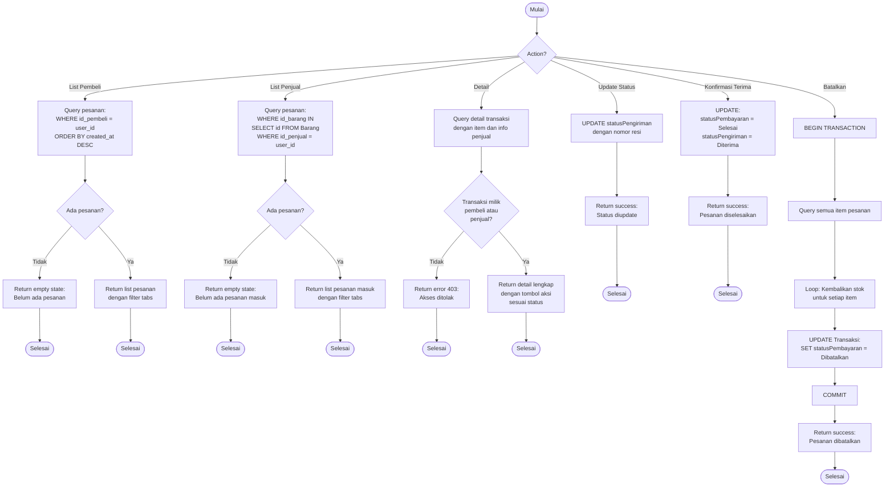

# Flowchart - PesananController

## Penjelasan Algoritma

**Input:**
- action (string: list_pembeli/list_penjual/detail/update_status/konfirmasi_terima/batalkan)
- id_transaksi (integer, untuk detail dan aksi lain)
- nomor_resi (string, optional untuk update_status)

**Proses:**
1. **List Pesanan Pembeli**
   - Query pesanan milik pembeli
   - Tampilkan dengan filter tabs

2. **List Pesanan Penjual**
   - Query pesanan yang berisi barang milik penjual
   - Tampilkan dengan filter tabs

3. **Detail Pesanan**
   - Query detail lengkap
   - Validasi ownership
   - Tampilkan dengan tombol aksi sesuai status

4. **Update Status Pengiriman**
   - Update statusPengiriman = 'Dikirim'
   - Simpan nomor resi

5. **Konfirmasi Terima**
   - Update statusPembayaran = 'Selesai'
   - Update statusPengiriman = 'Diterima'

6. **Batalkan Pesanan**
   - BEGIN TRANSACTION
   - Kembalikan stok semua item
   - Update status = 'Dibatalkan'
   - COMMIT

**Output:**
- **Success:** Data atau notifikasi sesuai action
- **Error:** Tampilkan pesan error
