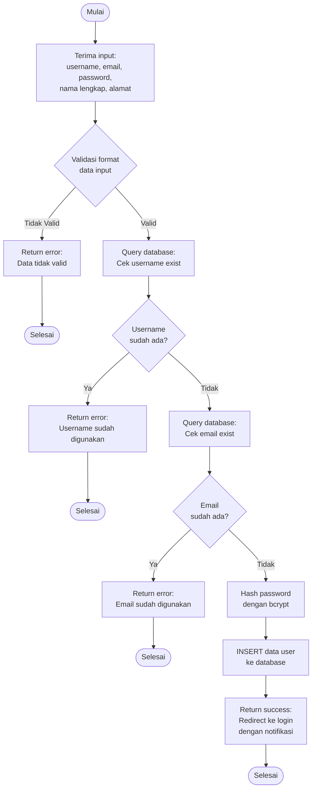

# Flowchart - RegistrasiController

## Penjelasan Algoritma

**Input:**
- username (string)
- email (string)
- password (string)
- nama_lengkap (string)
- alamat (string)

**Proses:**
1. **Validasi Format Data**
   - Cek semua field tidak kosong
   - Cek format email valid
   - Cek password minimal 6 karakter
   - Cek username hanya alphanumeric

2. **Cek Username**
   - Query ke database untuk cek username sudah ada atau belum
   - Jika sudah ada → return error

3. **Cek Email**
   - Query ke database untuk cek email sudah ada atau belum
   - Jika sudah ada → return error

4. **Hash Password**
   - Gunakan bcrypt untuk hash password

5. **Simpan ke Database**
   - INSERT record baru ke tabel users

**Output:**
- **Success:** Redirect ke halaman login dengan notifikasi "Registrasi berhasil"
- **Error:** Tampilkan pesan error sesuai kondisi
