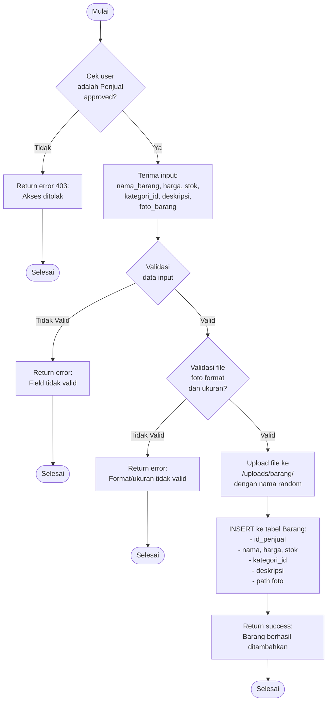

# Flowchart - TambahBarangController

## Penjelasan Algoritma

**Input:**
- nama_barang (string)
- harga (decimal)
- stok (integer)
- kategori_id (integer)
- deskripsi (text)
- foto_barang (file)

**Proses:**
1. **Cek Status Penjual**
   - Validasi user adalah penjual approved

2. **Validasi Data Input**
   - Nama tidak kosong
   - Harga > 0
   - Stok >= 0
   - Kategori exist

3. **Validasi File Foto**
   - Format: JPG, PNG
   - Ukuran maksimal 2MB
   - MIME type valid

4. **Upload File**
   - Simpan ke /uploads/barang/
   - Generate nama random

5. **Simpan ke Database**
   - INSERT dengan id_penjual = user yang login

**Output:**
- **Success:** Notifikasi "Barang berhasil ditambahkan"
- **Error:** Tampilkan pesan error
