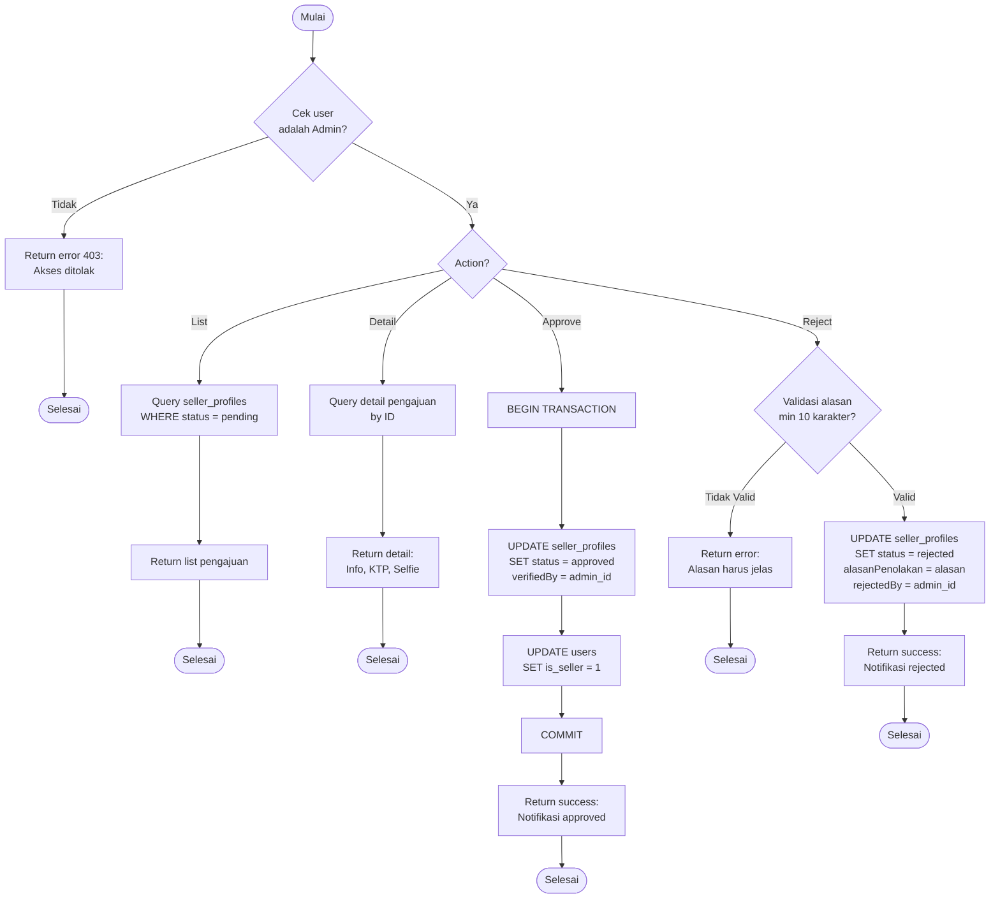

# Flowchart - VerifikasiPenjualController (Admin)

## Penjelasan Algoritma

**Input:**
- action (string: list/detail/approve/reject)
- id_pengajuan (integer, untuk detail/approve/reject)
- alasan_penolakan (string, untuk reject)

**Proses:**
1. **Cek Admin**
   - Validasi user adalah admin

2. **List Pengajuan**
   - Query semua pengajuan dengan status 'pending'

3. **Detail Pengajuan**
   - Query detail pengajuan tertentu dengan foto KTP dan Selfie

4. **Approve**
   - BEGIN TRANSACTION
   - Update status seller_profiles menjadi 'approved'
   - Update users set is_seller = 1
   - COMMIT

5. **Reject**
   - Validasi alasan minimal 10 karakter
   - Update status menjadi 'rejected' dengan alasan

**Output:**
- **Success:** Notifikasi sesuai action
- **Error:** Tampilkan pesan error
