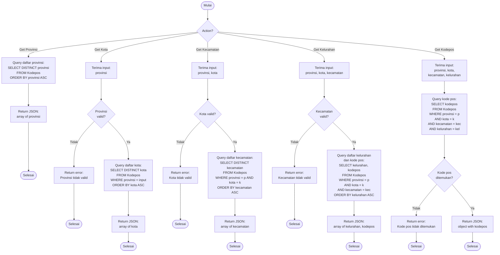

# Flowchart - WilayahController (API untuk Form Alamat)

## Penjelasan Algoritma

**Input:**
- action (string: get_provinsi/get_kota/get_kecamatan/get_kelurahan/get_kodepos)
- provinsi (string, untuk get_kota dan seterusnya)
- kota (string, untuk get_kecamatan dan seterusnya)
- kecamatan (string, untuk get_kelurahan dan get_kodepos)
- kelurahan (string, untuk get_kodepos)

**Proses:**
1. **Get Provinsi**
   - Query DISTINCT provinsi dari tabel Kodepos
   - Return array provinsi (sorted)

2. **Get Kota**
   - Terima input provinsi
   - Query DISTINCT kota WHERE provinsi = input
   - Return array kota (sorted)

3. **Get Kecamatan**
   - Terima input provinsi dan kota
   - Query DISTINCT kecamatan WHERE provinsi dan kota match
   - Return array kecamatan (sorted)

4. **Get Kelurahan**
   - Terima input provinsi, kota, kecamatan
   - Query kelurahan dan kodepos WHERE semua match
   - Return array of {kelurahan, kodepos}

5. **Get Kodepos**
   - Terima input lengkap: provinsi, kota, kecamatan, kelurahan
   - Query kode pos yang tepat
   - Return object {kodepos}

**Output:**
- **Success:** JSON response dengan data wilayah
- **Error:** JSON error message

**Catatan:**
- Controller ini biasanya digunakan untuk AJAX request
- Untuk populate dropdown cascading di form alamat
- Data wilayah diambil dari tabel Kodepos (data Indonesia)
